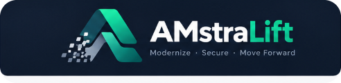

<p align="center">
  
</p>

# AMstraLift

> **Deterministic framework modernization and vulnerability remediation engine that verifies every change in an isolated sandbox before touching your code.**

[](LICENSE)
[](https://www.python.org/)
[]()
[]()
[](https://github.com/code-amalps/AMstraLift/releases)
[](https://github.com/code-amalps)

---

## 30-Second Summary

- **What is it?** A developer CLI and desktop GUI that automates major framework upgrades (e.g., Angular 14 $\to$ 18) and fixes security vulnerabilities (CVEs).
- **How is it different?** Most tools just bump version strings and leave you with broken builds. AMstraLift performs **deterministic AST code migrations** (standalone components, modern `@if`/`@for` control flow, configuration updates), executes **6 verification gates** in an isolated sandbox, and only proposes changes if the build and test suite pass.
- **Is there AI involved?** **No.** Zero LLMs in execution. All transformations are deterministic AST codemods, official framework schematics, and linters. No probabilistic guesses.
- **Can I test it safely?** **Yes.** Running with `--dry-run` or `--mode preview` never modifies your working tree. Stage A executes inside an isolated sandbox directory.

---

## The Problem: Why Version Bumping Breaks

Automated tools like Dependabot and Renovate treat software upgrades as simple string replacements:

```diff
- "@angular/core": "^14.2.0"
+ "@angular/core": "^18.2.0"
```

In real-world projects, major framework jumps are **architectural code migrations**:
1. Peer dependencies conflict and abort `npm install`.
2. Tooling schemas change (`browserTarget` was deprecated in favor of `buildTarget` in `angular.json`).
3. Compiler settings become obsolete (`baseUrl` and `ignoreDeprecations` break TypeScript 5).
4. Template directives change (`*ngIf` and `*ngFor` are replaced by `@if` and `@for`).
5. Modules are phased out in favor of standalone components.

When tools blindly submit PRs without migrating the code or verifying compilation, engineers spend days cleaning up broken builds.

---

## What AMstraLift Actually Does

AMstraLift automates the entire upgrade and verification lifecycle:

```text
Target Repository (Untouched)
       │
       ▼ [1. Discover & Scan]
       ├─ Discovers dependencies, monorepo subprojects, and Google OSV.dev CVEs
       │
       ▼ [2. Isolate Sandbox (Stage A)]
       ├─ Copies project to an isolated sandbox workspace
       ├─ Aligns companion packages, TypeScript, and lockfiles
       │
       ▼ [3. Deterministic Code Migration]
       ├─ AST codemods: template control flow (@if/@for), standalone components
       ├─ Config migrations: angular.json builders, tsconfig flags, scripts
       │
       ▼ [4. 6 Sandboxed Verification Gates]
       ├─ Gate 1: Clean Install  ──> Does the lockfile resolve without errors?
       ├─ Gate 2: Project Build  ──> Does the application and library compile?
       ├─ Gate 3: Unit Tests     ──> Does the test suite pass (headless Karma, Jest, pytest)?
       ├─ Gate 4: Security Rescan──> Were CVEs eliminated without introducing new ones?
       ├─ Gate 5: Strict Diff    ──> Were only authorized files modified?
       ├─ Gate 6: Semantic Diff  ──> Were public HTTP routes and symbols preserved?
       │
       ▼ [5. HMAC Attestation & Stage B Publishing]
       ├─ Signs the verified patch bundle with HMAC-SHA256
       └─ Proposes a verified PR branch or generates a clean patch
```

---

## Real Proof: Angular 15 $\to$ 18 Modernization

Here is an actual code transformation performed by AMstraLift's deterministic AST transformer:

### Before: Legacy Template & NgModule Dependencies
```html
<div *ngIf="user$ | async as user">
  <span>Welcome, {{ user.name }}</span>
</div>

<ng-container *ngIf="isAdmin">
  <admin-panel></admin-panel>
</ng-container>

<ul>
  <li *ngFor="let item of items; trackBy: customTrack">
    {{ item }}
  </li>
</ul>
```

### After: Migrated Modern Control-Flow Syntax
```html
@if (user$ | async; as user) {
  <div>
    <span>Welcome, {{ user.name }}</span>
  </div>
}

@if (isAdmin) {
  <admin-panel></admin-panel>
}

@for (let item of items; track customTrack) {
  <ul>
    <li>{{ item }}</li>
  </ul>
}
```

### Accompanying Manifest & Configuration Updates
- `@angular/core`, `@angular/common`, `@angular/cli`: bumped to `^18.2.0`
- `typescript`: pinned to `^5.4.5` (aligned with Angular 18 requirements)
- `angular.json`: migrated `browserTarget` to `buildTarget`; updated to `@angular/build`
- `tsconfig.json`: purged obsolete `baseUrl` deprecations
- `package-lock.json`: rebuilt cleanly with companion devkits aligned

### Verification Gate Output Log
```text
[AMstraLift] Executing Stage A sandbox verification...
  ↳ [Gate 1/6] Clean Install ('npm ci').......................... [PASSED] (18.4s)
  ↳ [Gate 2/6] Project Build ('ng build')........................ [PASSED] (14.2s)
  ↳ [Gate 3/6] Unit Tests ('ng test --watch=false').............. [PASSED] (8.9s)
  ↳ [Gate 4/6] Security Rescan (OSV.dev)......................... [PASSED] (0 vulnerabilities found)
  ↳ [Gate 5/6] Strict Diff Validation............................ [PASSED] (No unauthorized paths)
  ↳ [Gate 6/6] Semantic & Contract Diff.......................... [PASSED] (0 breaking route/symbol violations)

✔ All 6 verification gates passed.
✔ Cryptographically attested evidence bundle generated.
✔ Stage B: PR proposal created on branch 'amstralift/upgrade-angular-18'.
```

---

## Why AMstraLift is Different

| Feature | Dependabot / Renovate | Copilot / AI Bots | AMstraLift |
| :--- | :---: | :---: | :---: |
| **Execution Mechanism** | String replacement | Probabilistic LLM | Deterministic AST & Codemods |
| **Code Migration (Syntax)** | ❌ No | ⚠️ Inconsistent / Hallucinates | ✔️ Yes (Standalone, Control Flow) |
| **Sandboxed Verification** | ❌ None | ❌ None | ✔️ 6 sequential sandbox gates |
| **Build & Test Verification** | ❌ (leaves for CI) | ❌ No | ✔️ Verified locally before PR |
| **Semantic Contract Diff** | ❌ No | ❌ No | ✔️ Checks routes, symbols, configs |
| **Vulnerability Remediation** | Bump only | Text fix | OSV.dev dependency graph + overrides |
| **Monorepo Polyglot Support** | File-by-file | Chat window | Recursive multi-project scanner |
| **Human Review Workflow** | PR only | Chat output | Attested Evidence Bundle + PR |

---

## Supported Ecosystems & Truthful Status Matrix

We believe in being 100% transparent about what the codebase can demonstrably do today versus what requires external tooling or is in active development:

| Ecosystem | Detection | Version Upgrade | Code Modernization (AST/Codemods) | Sandbox Build Gate | Sandbox Test Gate | CVE Remediation | Maturity Level |
| :--- | :---: | :---: | :---: | :---: | :---: | :---: | :---: |
| **Angular** | ✔️ `angular.json` & `package.json` | ✔️ v12 $\to$ v19 (GA releases) | ✔️ Standalone, Control Flow, M2 theming, tsconfig, scripts | ✔️ Library-first build ordering | ✔️ Karma (headless Chrome), Jest, Vitest | ✔️ Direct & transitive npm overrides | **Production Ready** |
| **.NET** | ✔️ `.csproj` & `Directory.Build.props` | ✔️ NuGet + Central Package Mgmt (CPM) | ⚠️ Delegates to `dotnet format` (style, whitespace, analyzers) | ✔️ `dotnet build` | ✔️ `dotnet test` | ✔️ NuGet pin overrides | **Stable** (Requires .NET SDK) |
| **Python** | ✔️ `requirements.txt` & `pyproject.toml` | ✔️ PyPI stable releases | ⚠️ Delegates to `ruff` / `pyupgrade` when installed | ✔️ Syntax & imports check | ✔️ `pytest` | ✔️ Pinned dependency updates | **Stable** (Requires Python runtime) |
| **React** | ✔️ `package.json` (React/Next.js) | ✔️ npm registry stable | ⚠️ Updates JSX transform (`react-jsx`), runs `eslint --fix` | ✔️ `npm run build` | ✔️ `npm test` | ✔️ Direct & transitive npm overrides | **Partial** (No class $\to$ hook refactoring) |

---

## The 6 Verification Gates

Every upgrade must survive 6 sequential gates in an isolated sandbox before AMstraLift will propose a pull request:

1. **Gate 1: Clean Install** — Can the upgraded dependency graph resolve from scratch? Ensures zero peer dependency deadlocks (`npm ci`, `dotnet restore`).
2. **Gate 2: Project Build** — Does the application and all internal libraries compile? In Angular workspaces, libraries are compiled first so dependent applications resolve cleanly.
3. **Gate 3: Regression Tests** — Does your existing test suite still pass? Injects headless browser flags (`--browsers=ChromeHeadless --watch=false`) to prevent test runners from hanging.
4. **Gate 4: Security Rescan** — Did the targeted vulnerability actually disappear? Did the upgraded packages accidentally introduce new CVEs? Verified against Google's OSV.dev database.
5. **Gate 5: Strict Diff Validation** — Did the modernization touch only intended files? Rejects unauthorized file creation, path traversal attempts, or accidental build artifact leakage.
6. **Gate 6: Semantic & Contract Diff** — Did the modernization break your public contract? Extracts HTTP API routes, exported classes/symbols, and environment configuration keys before and after modernization. Flags breaking changes as verification failures even if the code builds.

### What Happens If a Gate Fails?
- **Safe Rollback**: Your target repository remains completely untouched.
- **Transactional Refusal**: Under our Partial Modernization Engine, if an individual file transformation fails, it is rolled back without poisoning other safe transformations.
- **Smart Diagnostics (`--draft-on-fail`)**: If desired, AMstraLift can generate a draft pull request containing the exact compiler error diagnostics and failed gate output so you can inspect what broke.

---

## Quickstart: Try It Safely in 60 Seconds

### Prerequisites & Requirements

| Component | For Standalone Binary (`amstralift.exe`) | For Python Package / Source |
| :--- | :--- | :--- |
| **AMstraLift Runtime** | **None** (Self-contained, includes Python & GUI) | Python 3.11+ and `uv` or `pip` |
| **Target Project Tooling** | Requires the CLI for your target repo (e.g., `node`/`npm` for Angular/React, `dotnet` for .NET, `python` for Python) | Requires the CLI for your target repo |

---

### Option A: Standalone Windows Executable (Zero Python Setup)

1. Download **`amstralift.exe`** from [GitHub Releases](https://github.com/code-amalps/AMstraLift/releases).
2. Double-click **`amstralift.exe`** to launch the Desktop GUI.
3. Select your repository folder, choose **Preview Mode**, and click **Run Security Audit** or **Run AMstraLift Upgrade**.

---

### Option B: CLI Quickstart (Windows, Linux, macOS)

```bash
# 1. Clone the repository
git clone https://github.com/code-amalps/AMstraLift.git
cd AMstraLift

# 2. Install dependencies with uv (or pip)
uv sync --group dev

# 3. (Optional) Scaffold an Angular/React/.NET/Python starter repository
uv run amstralift init --repo ./my-starter --ecosystem angular

# 4. Test on a repository in SAFE PREVIEW MODE (zero files modified)
uv run amstralift audit --repo /path/to/your/project --mode preview

# 5. Run a full modernization DRY-RUN
uv run amstralift run --repo /path/to/your/project --dry-run

# 6. Launch the Desktop GUI
uv run amstralift gui
```

---

## Current Limitations (Brutal Honesty)

To save you time, here is what AMstraLift **cannot** or does **not** do today:

1. **AngularJS (1.x) is not supported**: AMstraLift supports modern Angular (v12 through v19). It cannot migrate legacy AngularJS 1.x directives to Angular 2+.
2. **React does not refactor component syntax**: The React adapter upgrades packages, sets up modern JSX transforms, and fixes lint issues. It will not rewrite legacy React class components into functional components with hooks.
3. **No test generation**: AMstraLift executes your *existing* test suite. If your project has 0% test coverage, Gate 3 will report `SKIPPED` or `UNCERTAIN`—it cannot fabricate tests for you.
4. **Karma requires a headless browser**: Angular unit tests running Karma need Chrome or Chromium installed on the host machine to execute headless tests. If missing, Gate 3 flags `UNCERTAIN`.
5. **Does not prove mathematical correctness**: AMstraLift proves that your code compiles, tests pass, dependencies resolve, and semantic contracts (routes/symbols) are preserved. It does not replace code review.

---

## Technical Architecture & Security Model

```text
┌────────────────────────────────────────────────────────┐
│                   STAGE A: SANDBOX                     │
│  (Isolated temporary copy of repository)              │
│                                                        │
│   Candidate -> AST Transforms -> 6 Verification Gates   │
│                                                        │
│   Produces: Verified Patch + GateVerificationRecord    │
└──────────────────────────┬─────────────────────────────┘
                           │
                           ▼
┌────────────────────────────────────────────────────────┐
│             CRYPTOGRAPHIC ATTESTATION                  │
│                                                        │
│   HMAC-SHA256 signature generated over:                │
│   - Patch SHA-256                                      │
│   - Base commit SHA & Head commit SHA                  │
│   - 6-Gate verification results & semantic diff        │
│   - Execution timestamp & TTL                          │
└──────────────────────────┬─────────────────────────────┘
                           │
                           ▼
┌────────────────────────────────────────────────────────┐
│                   STAGE B: PUBLISHER                   │
│  (Target repository / Git remote)                      │
│                                                        │
│   1. Validates HMAC signature & freshness              │
│   2. Verifies working tree cleanliness                 │
│   3. Applies verified patch & commits                  │
│   4. Opens Pull Request with attested evidence report  │
└────────────────────────────────────────────────────────┘
```

### What Cryptographic Attestation Actually Means
We use HMAC-SHA256 signing between Stage A and Stage B:
- **What it proves:** It cryptographically guarantees that the patch published in Stage B is **byte-for-byte identical** to the patch that executed and passed all 6 gates in the Stage A sandbox, and that no third-party process tampered with the patch between stages.
- **What it does NOT prove:** It does *not* prove that the code is free of bugs. Code correctness is verified empirically by your build and test suites, not by cryptographic hashes.

---

## Testing Evidence

AMstraLift is developed with strict test coverage across every adapter, security boundary, and verification gate:

```bash
# Run the full test suite
uv run pytest
```

```text
======================= 300 passed in 38.4s =======================
```

Key test suites included in the repository:
- `tests/test_angular_adapter.py` — Angular version resolution, lockfile updates, and schematics
- `tests/test_modernize.py` — Control flow AST codemods and standalone component inference
- `tests/test_gate_6_semantic_diff.py` — Route, symbol, and config contract preservation
- `tests/test_safe_remediation.py` — OSV CVE discovery, dependency graph, and overrides
- `tests/test_partial_modernization.py` — Transactional rollback and refusal integrity
- `tests/test_crypto.py` — HMAC signing, tampering rejection, and TTL expiration
- `tests/test_security.py` — Path traversal rejection, forbidden file filtering, symlink defense
- `tests/test_monorepo.py` — Polyglot monorepo topology detection

---

## 🤝 Help Test AMstraLift

AMstraLift is under active development by **Amal P S**. We are seeking developers maintaining real-world codebases to test AMstraLift against challenging upgrades.

### How You Can Test (5-Minute Workflow)
1. Pick an application with outdated dependencies or known CVEs.
2. Create a disposable test branch (`git checkout -b test/amstralift-eval`).
3. Run `amstralift run --repo . --dry-run` or launch the desktop GUI (`amstralift gui`).
4. Inspect the generated diff and the verification gate summary.
5. Report your findings:
   - If an upgrade failed or crashed: Open an **[Upgrade Failure Report](https://github.com/code-amalps/AMstraLift/issues/new?template=upgrade_failure.md)**.
   - If you found a bug in the CLI/GUI: Open a **[Bug Report](https://github.com/code-amalps/AMstraLift/issues/new?template=bug_report.md)**.
   - If you need support for a specific migration pattern: Open a **[Feature Request](https://github.com/code-amalps/AMstraLift/issues/new?template=feature_request.md)**.

*(Please do not submit private source code or secrets in issue reports).*

---

## Roadmap

- **Generation 1 (Completed — v0.1.18)**: Multi-ecosystem upgrade engine, Angular AST modernization, 6 verification gates, OSV CVE remediation, HMAC attestation, GUI + REST API, monorepo discovery, starter scaffolding, standalone distribution.
- **Generation 2 (In Progress)**:
  - **P16**: Transformation Dependency Graph (modeling prerequisites, conflicts, and parallelizable sets).
  - **P17**: Modernization Planning Engine (declarative upgrade plans).
  - **P18**: Pre-execution Cross-Transformation Conflict Detection.
  - **P19**: Resumable / Checkpointed Modernization (`amstralift resume`).
  - **P20**: Policy-as-Code (declarative enterprise rules).

---

## Copyright & License

Copyright (C) 2026 **Amal P S**. All rights reserved.

AMstraLift is open-source software licensed under the **[GNU Affero General Public License v3.0 (AGPL-3.0-or-later)](LICENSE)** with Section 7 author attribution notices.

### Important Notes on License & Usage
- **Free for Developers:** Individual developers, open-source maintainers, researchers, and engineering teams are completely free to inspect, download, use, and evaluate AMstraLift to upgrade their repositories without cost or subscription fees.
- **Your Code Remains Your Code:** Using AMstraLift to transform, upgrade, or remediate your repository **does NOT** subject your application source code to the AGPL license. AMstraLift claims zero copyright over the pull requests, patches, or code changes it generates.
- **Attribution (Section 7b):** All redistributions, forks, and user-facing interfaces (CLI banners and GUI headers) must preserve the original author attribution: *"Engineered by Amal P S"*.
- *The [LICENSE](LICENSE) file is the authoritative legal document.*

---

**Author:** Amal P S  
**GitHub:** [@code-amalps](https://github.com/code-amalps)  
**Repository:** [https://github.com/code-amalps/AMstraLift](https://github.com/code-amalps/AMstraLift)
